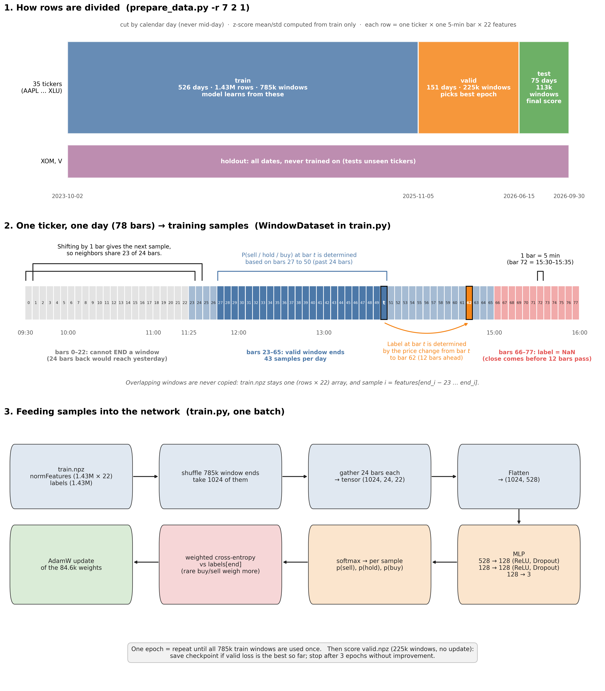

## 1. Fetch data
Run
```bash
python NeuralNetwork/fetch_samples.py
```

## 2. Prepare data
- Input : NeuralNetwork/data/*.csv
- Output: NeuralNetwork/data_npz/{train,valid,test,holdout}.npz

1. **Clean**: removes off-hour bars, because they are spurious and low in volume, mostly noise. This results in fully packed good valid bars for all symbols.

    | Session  | Hours (US/Eastern) | 5-min bars          |
    |----------|--------------------|---------------------|
    | Full day | 09:30 – 16:00      | 6 + 12 × 6 = 78/day |
    | Half day | 09:30 – 13:00      | 6 + 12 × 3 = 42/day |

2. **Features**: computes training features and same-day labels for every symbol, with SPY returns as market context.
3. **Split**: splits by calendar day into train/valid(/test). Holdout is for testing tickers that did NOT enter training (generalizability test).
4. **Normalize**: z-scores every split with train-set stats only, clipped at ±5σ.

```bash
python NeuralNetwork/prepare_data.py           # train : valid = 8 : 2
python NeuralNetwork/prepare_data.py -r 7 2 1  # adds test.npz
```

### 2.1 npz files
`np.load(path).files` gives `['normFeatures', 'labels', 'ticker', 'timestamp', 'columns', 'mean', 'std']`
- **normFeatures**: 22 features (per 5-min row), 14 defined in [BDT/features.py](../BDT/features.py) and 8 (Time, SPY) in [prepare_data.py](prepare_data.py).

    | Momentum | Volatility | Volume | Returns | Time | SPY |
    |---|---|---|---|---|---|
    | • `rsi_14`<br>• `macd`<br>• `macd_hist`<br>• `cross` | • `atr_14`<br>• `bb_width`<br>• `bb_pos` | • `vol_zscore`<br>• `vol_delta`<br>• `vwap_dev` | • `ret_1`<br>• `ret_5`<br>• `ret_10`<br>• `ret_30` | • `tod_sin`<br>• `tod_cos`<br>• `dow_sin`<br>• `dow_cos` | • `spy_ret_1`<br>• `spy_ret_5`<br>• `spy_ret_10`<br>• `spy_ret_30` |
- **labels**: Integer indicating +1(buy), 0(hold), -1(sell), or NaN(last 12 bars of day)
    - buy(+1): Next 12 bars increased more than a threshold,
    - sell(-1): Next 12 bars decreased more than a threshold,
    - hold(0): Next 12 bars change didn't exceed a threshold,
    - NaN: Current code only does intraday trading, so last 12 bars can't have 12 future bar info. This prevents bias in training.
- **ticker**: String per row.
- **columns**: List of 22 strings that list `normFeatrues`.
- **mean & std**: List of 22 floats that specify the mean and std of each feature. Used for Z-score normalization.

## 3. Train
- Input : `NeuralNetwork/data_npz/{train,valid}.npz`
- Output: `NeuralNetwork/models/mlp_w{window}.pt`
```
python train.py
```


